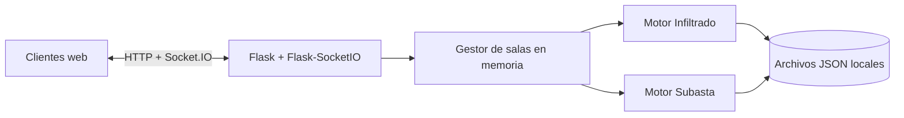

# Arquitectura

Flask entrega las páginas y recursos estáticos. Socket.IO mantiene eventos de sala en tiempo real. Cada sala conserva su estado en memoria; cada motor expone una vista por jugador para limitar datos privados. El backend valida las acciones antes de mutar el estado.

## Módulos

- `app.py`: rutas, salas, validación de acceso, difusión de estado y temporizador.
- `juegos/infiltrado/juego.py`: roles, rondas, votación y desempate.
- `juegos/subasta/juego.py`: baraja de versiones, pujas, presupuesto y plantillas.
- `data/*.json`: contenido editable sin base de datos.
